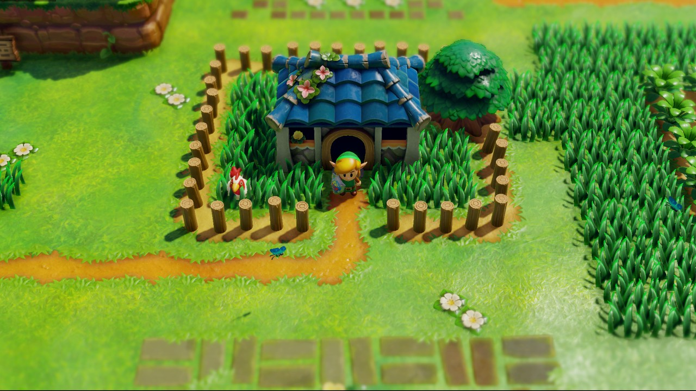

<!-- game facts: made by docs/gen_tables.py from android.tsv; edit android.tsv, not this block -->
# The Legend of Zelda: Link's Awakening

| | |
|---|---|
| Status | **playable** |
| Title ID | `01006BB00C6F0000` |
| Tested with nx2android | `v0.4.0` |
| Tested build and device | v131072 Retroid Pocket 6 (Snapdragon 8 Gen 2, Adreno 740, Turnip T30, Android 13), 2026-11-16: 60 fps with the GPU turbo, boot to Marin and Tarin's house, docked and handheld |
| App package | `org.nx2a.t01006bb00c6f0000` |

The profile sets these for you (`android.tsv`); a player changes the pause menu ones in the game, and the env rows in the data pack's `env.txt`:

| Row | What it does |
|---|---|
| `DM_VK_BIND_ALIAS=52fcbb4ca2a78907:2=3:4=3` | <shader key>:<binding>=<binding>[:...]: a shader's texture binding reads another binding's texture |
| `DM_FPS_PIN=60` | pin the governor at 60, 40 or 30 fps; 0 = no pin |
| `DM_GPU_TURBO=1` | "auto" or 1: ask the GPU for its high clocks while the game is GPU-bound; unset or 0 = no |
| `DM_VK_FS_NOKILL=b27d97baf39e51b6` | pixel shader keys whose discards are left out (comma-separated) |

Read the profile's porting log in the comment header of [`android.tsv`](android.tsv). Back to the [games list](../../../../README.md#games).
<!-- end of the game facts -->

## Game version

- Update 1.1.0.
- The profile was checked with `v131072` (the `tested` row of android.tsv).

## Frame rate

- 60 fps (drops to 30 on slow frames by default; uncomment the two NOPs in `patches.py` to hold 60 on fast chips — may cause judder and slow-motion on older devices).

## Tested devices

| Device | GPU | Vulkan driver | Game version | nx2android | Result |
|---|---|---|---|---|---|
| Lenovo TB323FU (Snapdragon 8 Elite Gen 5, Adreno 840, Android 16) | Adreno 840 | not recorded | 1.1.0 (v131072) | `v0.4.0` | playable |

Tested on the Lenovo TB323FU (Snapdragon 8 Elite Gen 5, Adreno 840).

## Options

- Needs your console's firmware for its fonts (`--firmware`): without them the game crashes at startup because the fallback font lacks `U+25A1`.

## Quirks and known issues

- A new area can hitch while it loads.
